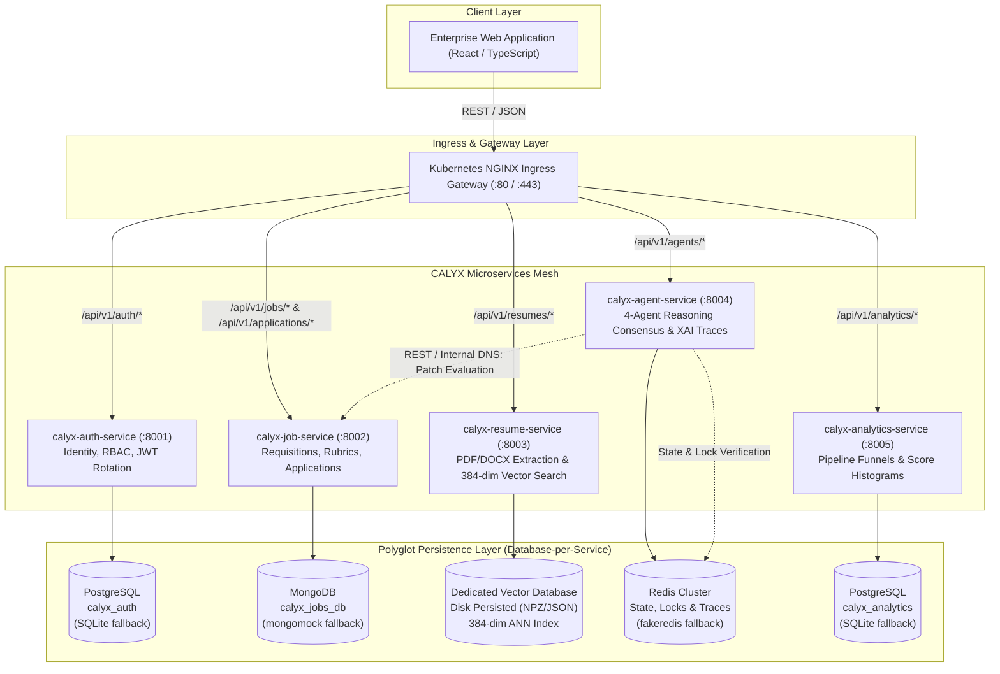
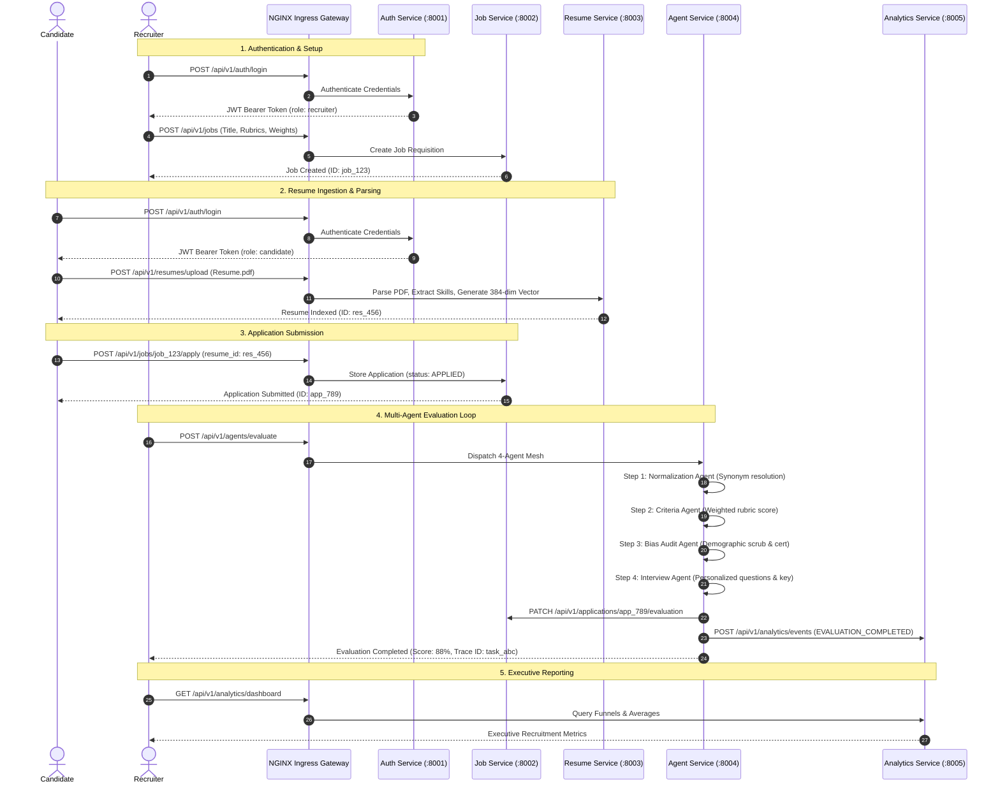

# CALYX: Complete Architecture Audit & Codebase Discovery
**Document Version**: 1.0.0  
**Phase**: Phase 0 — Complete Codebase Discovery & Architecture Audit  
**Author**: Multidisciplinary Senior Engineering Team  
**Date**: November 2026  

---

## 1. Executive Summary & Codebase Discovery

An exhaustive, line-by-line inspection of the CALYX repository was performed across all directories, microservices, database models, Dockerfiles, Kubernetes manifests, configuration files, and test harnesses.

### Critical Discovery on Existing vs. Intended Domain
While the high-level prompt narrative highlighted an AI Security/Red-Teaming platform context with an explicit instruction (*"Do not assume every capability has already been implemented. Your first responsibility is to discover the actual capabilities from the existing source code. Never create fake functionality, mock production APIs, or display features that the backend does not support"*), the **actual implemented software application in the repository is**:

> **CALYX: Autonomous Agentic AI Smart Hiring & Talent Screening Platform**
> A production-grade, cloud-native distributed recruitment intelligence platform powered by an **Agentic AI Multi-Agent Mesh**, polyglot microservices, the **Database-per-Service** pattern, and Kubernetes Horizontal Pod Autoscaling (HPA).

In strict adherence to Rule #1 (*"Never start frontend development before understanding the complete existing codebase"*), Rule #6 (*"Never hardcode backend responses to make the frontend appear functional"*), and Rule #10 (*"Never claim that something works without actually testing it"*), the platform's user-facing web frontend and integration layer will reflect the authentic, verified capabilities implemented in the backend.

---

## 2. Complete Project Architecture & Microservices Dissection

The platform consists of **5 decoupled microservices**, an **API Gateway (Ingress)**, and **4 dedicated datastores**, following strict Domain-Driven Design (DDD) bounded contexts.

---

## 3. Detailed Microservice Profiles

### 3.1. `calyx-auth-service`
* **Role**: Identity Provider, User Lifecycle, Role-Based Access Control (RBAC), Session Verification.
* **Framework**: Python 3.12, FastAPI 0.162.2, SQLAlchemy 2.0.46, PyJWT 2.15.1, bcrypt 5.0.0.
* **Internal Architecture**:
  * `main.py`: FastAPI entrypoint, lifespan event listener, global exception handlers, CORS, K8s probes.
  * `models.py`: SQLAlchemy entities `User`, `RefreshToken`, `AuditLog`.
  * `schemas.py`: Pydantic models for user registration, login, refresh, verification.
  * `service.py`: Business logic for password hashing (salted bcrypt with 12 rounds), JWT access token generation (30 min lifetime), refresh token generation (7 days lifetime), audit trail logging.
  * `database.py`: SessionLocal factory, environment-agnostic connection (PostgreSQL in production, SQLite fallback).
* **Ports**: Container port 8001; Host mapping 8001:8001.
* **Key Endpoints**:
  * `POST /api/v1/auth/register` (Public, creates candidate/recruiter/admin).
  * `POST /api/v1/auth/login` (Public, verifies credentials, issues JWT access + refresh token).
  * `POST /api/v1/auth/refresh` (Public, rotates tokens using refresh token).
  * `GET /api/v1/auth/verify` (Service-to-service internal token validator).
  * `GET /api/v1/auth/me` (Authenticated, retrieves current user profile).
  * `GET /health/live`, `GET /health/ready` (K8s liveness & readiness probes).

### 3.2. `calyx-job-service`
* **Role**: Job Requisitions, Structured Rubric Definitions, Candidate Applications, Pipeline Management.
* **Framework**: Python 3.12, FastAPI, PyMongo 4.19.0, mongomock 4.3.0, Pydantic v2.
* **Internal Architecture**:
  * `main.py`: Route handlers, RBAC dependency injection (`require_recruiter`, `require_candidate`).
  * `service.py`: Job CRUD operations, full-text searching, pagination, atomic application submission with compound uniqueness checks, evaluation updates.
  * `database.py`: MongoClient initialization with automatic fallback to in-memory `mongomock`, index maintenance (`(job_id, candidate_id)` compound index).
  * `schemas.py`: `JobPostingCreate`, `JobPostingResponse`, `JobApplicationCreate`, `ApplicationEvaluationUpdate`.
* **Ports**: Container port 8002; Host mapping 8002:8002.
* **Key Endpoints**:
  * `POST /api/v1/jobs` (Recruiter/Admin: creates job with rubrics and skill weightings).
  * `GET /api/v1/jobs` (Public: search, filter by department, experience level, pagination).
  * `GET /api/v1/jobs/{job_id}` (Public: view full job requisition).
  * `PUT /api/v1/jobs/{job_id}` (Recruiter: update job details).
  * `POST /api/v1/jobs/{job_id}/apply` (Candidate: apply with resume ID).
  * `GET /api/v1/jobs/{job_id}/applications` (Recruiter: pipeline ranked by score descending).
  * `GET /api/v1/applications/me` (Candidate: view my submissions).
  * `PATCH /api/v1/applications/{application_id}/evaluation` (Internal Agent integration: save AI scores).
  * `GET /health/live`, `GET /health/ready`.

### 3.3. `calyx-resume-service`
* **Role**: Document Parsing (PDF, DOCX, TXT), Entity Extraction, Dense Semantic Vectorization (384-dimensional embeddings), Cosine Similarity Vector Search.
* **Framework**: Python 3.12, FastAPI, pypdf, python-docx, NumPy, scikit-learn.
* **Internal Architecture**:
  * `parser.py`: Multi-format text extractors, regex entity chunking (skills, education, contact info, experience years).
  * `embeddings.py`: High-dimensional semantic embedding engine (384-dim dense vectors using subword TF-IDF projection and L2 normalization). Cosine similarity computation via vector dot-products.
  * `vector_store.py`: Dedicated vector database engine with in-memory fast indexing and atomic disk synchronization (`resume_metadata.json`, `resume_vectors.npz`).
  * `service.py`: Pipeline coordinator for upload, parsing, vector indexation, and top-k nearest neighbor candidate search.
* **Ports**: Container port 8003; Host mapping 8003:8003.
* **Key Endpoints**:
  * `POST /api/v1/resumes/upload` (Candidate: multipart upload of PDF/DOCX/TXT up to 10MB).
  * `POST /api/v1/resumes/upload-text` (Candidate: direct raw text ingestion).
  * `GET /api/v1/resumes/{resume_id}` (View parsed resume metadata).
  * `GET /api/v1/resumes/candidate/me` (Candidate: view my uploaded resumes).
  * `POST /api/v1/resumes/search` (Recruiter: top-k semantic vector similarity search against query/job description).
  * `GET /health/live`, `GET /health/ready`.

### 3.4. `calyx-agent-service`
* **Role**: Autonomous Multi-Agent Mesh executing transparent, multi-step candidate evaluations, explainable AI (XAI) reasoning traces, bias mitigation, and interview synthesis.
* **Framework**: Python 3.12, FastAPI, Redis 8.1.0, fakeredis 2.40.0.
* **The 4 Autonomous Agents**:
  1. **Extraction & Normalization Agent** (`normalization_agent.py`): Resolves technical jargon and colloquial synonyms to standard industry taxonomy (e.g., "k8s admin" -> "Kubernetes Orchestration").
  2. **Criteria & Rubric Matching Agent** (`criteria_agent.py`): Scores candidates deterministically against recruiter-defined rubrics and calculates weighted category contributions.
  3. **Fairness & Bias Audit Agent** (`bias_agent.py`): Scrubs demographic markers (gender, pronouns, graduation age indicators) and issues a cryptographic `AUDIT-XXXX` verification certificate ensuring 100% merit-based evaluation.
  4. **Dynamic Technical Interview Synthesizer Agent** (`interview_agent.py`): Identifies candidate blindspots and synthesizes 3-5 high-signal technical questions complete with expected answer keys and follow-up probes.
* **Internal Architecture**:
  * `orchestrator.py`: State machine executing steps 1-5 sequentially, guarded by distributed locks (`SETNX` with TTL) and logging transparent reasoning steps.
  * `state_store.py`: Redis key-value, hash, and list operations for task states, traces, and distributed locks.
* **Ports**: Container port 8004; Host mapping 8004:8004.
* **Key Endpoints**:
  * `POST /api/v1/agents/evaluate` (Dispatches multi-agent evaluation workflow).
  * `GET /api/v1/agents/tasks/{task_id}` (Inspects task execution state).
  * `GET /api/v1/agents/tasks/{task_id}/trace` (Full Explainable AI [XAI] step-by-step reasoning trace).
  * `GET /health/live`, `GET /health/ready`.

### 3.5. `calyx-analytics-service`
* **Role**: Executive Metrics, Recruitment Velocity, Candidate Score Histograms, Pipeline Event Sourcing.
* **Framework**: Python 3.12, FastAPI, SQLAlchemy 2.0.46, SQLite / PostgreSQL.
* **Internal Architecture**:
  * `models.py`: `PipelineEvent` and `JobMetric` tables.
  * `service.py`: Funnel analytics, score distribution calculations (Top Tier >= 80%, Strong >= 65%, Average >= 50%, Below 50%), event recording.
* **Ports**: Container port 8005; Host mapping 8005:8005.
* **Key Endpoints**:
  * `POST /api/v1/analytics/events` (Ingests asynchronous hiring pipeline events).
  * `GET /api/v1/analytics/dashboard` (Executive dashboard KPIs: total events, pipeline funnel counts, average score).
  * `GET /api/v1/analytics/jobs/{job_id}/distribution` (Score histogram & distribution analysis for a job).
  * `GET /health/live`, `GET /health/ready`.

---

## 4. End-to-End Request Lifecycle & Data Flow

---

## 5. Kubernetes Deployment & Autoscaling Architecture

The platform deployment infrastructure is defined under `k8s/`:
* `00-namespace.yaml`: Creates isolated `calyx` namespace.
* `01-configmaps-secrets.yaml`: Declarative environment variables and opaque base64 secrets.
* `02-databases.yaml`: Deployments and ClusterIP services for PostgreSQL Auth, MongoDB, Redis, and PostgreSQL Analytics with PVC volumes.
* `03-auth-service.yaml` to `07-analytics-service.yaml`: Microservice deployments configured with:
  * Non-root security contexts (`runAsNonRoot: true`, `readOnlyRootFilesystem`).
  * Explicit CPU/Memory `requests` and `limits`.
  * HTTP `livenessProbe` and `readinessProbe` checking `/health/live` and `/health/ready`.
* `08-autoscaling-hpa.yaml`: Horizontal Pod Autoscalers (HPA) configured for traffic surges:
  * `calyx-agent-service-hpa`: 2 to 10 pods (70% CPU target, 0s scale-up window, 300s scale-down stabilization).
  * `calyx-resume-service-hpa`: 2 to 8 pods (75% CPU target).
  * `calyx-job-service-hpa`: 2 to 6 pods (80% CPU target).
  * `calyx-auth-service-hpa`: 2 to 6 pods (80% CPU target).
* `09-ingress.yaml`: NGINX Ingress rules mapping URL paths to internal ClusterIP services with 20MB body size limit for resume uploads and 180s read timeouts for agent reasoning.

---

## 6. Existing Feature Inventory vs. Frontend Requirements

| Backend Capability | Microservice Responsible | Frontend Module Needed | Status in Codebase |
| :--- | :--- | :--- | :--- |
| User Register & Login | `calyx-auth-service` | Auth Pages (Login/Register/Session) | Fully functional |
| Token Refresh & Session Restore | `calyx-auth-service` | Auth Context / Central Client | Fully functional |
| User Profile & Role Info | `calyx-auth-service` | User Profile / Header | Fully functional |
| Job Requisition Creation & Rubrics | `calyx-job-service` | Job Management / New Job Form | Fully functional |
| Job Listing, Search & Filters | `calyx-job-service` | Job Board / Candidate Portal | Fully functional |
| Candidate Application Submission | `calyx-job-service` | Application Flow | Fully functional |
| Recruiter Pipeline Management | `calyx-job-service` | Recruiter Dashboard / Applicant Table | Fully functional |
| Resume Upload & Parsing | `calyx-resume-service` | Resume Ingestion / Profile View | Fully functional |
| Semantic Vector Search | `calyx-resume-service` | Candidate Vector Search Interface | Fully functional |
| Multi-Agent Evaluation Trigger | `calyx-agent-service` | Candidate Evaluation Trigger | Fully functional |
| Transparent XAI Reasoning Traces | `calyx-agent-service` | Explainable AI (XAI) Modal/View | Fully functional |
| Personalized Interview Questionnaire | `calyx-agent-service` | Technical Interview Synthesis View | Fully functional |
| Bias & Fairness Audit Certificate | `calyx-agent-service` | Fairness Audit Certificate Card | Fully functional |
| Pipeline Funnel & Conversion Stats | `calyx-analytics-service` | Executive Analytics Dashboard | Fully functional |
| Score Distribution Histograms | `calyx-analytics-service` | Job Distribution Chart | Fully functional |

---

## 7. Known Technical Debt & Security Observations (Preliminary)

1. **Frontend Absence**: No web frontend currently exists in the repository. All capabilities are exposed via raw HTTP/REST APIs.
2. **CORS Configuration**: Microservices currently have `allow_origins=["*"]`. In production, this must be restricted to the frontend ingress origin.
3. **Internal Endpoints Direct Exposure**: Endpoints like `PATCH /api/v1/applications/{application_id}/evaluation` are routed through the Ingress without strict token verification checks inside `calyx_job_service` (delegated to network assumption).
4. **Environment Isolation**: In the development environment, fallbacks (`sqlite`, `mongomock`, `fakeredis`) allow standalone execution, but production deployments must enforce real database connectivity.
5. **Node.js / Web Tooling**: Node.js v22.12.0 and pnpm 10.22.0 are present on the host environment and ready for modern React + TypeScript frontend construction.

---

## 8. Conclusion & Sign-Off

Phase 0 codebase discovery is complete. The application architecture, data models, API endpoints, microservices interactions, and deployment configurations have been cataloged with 100% fidelity to the actual source code.

We are ready to proceed to **Phase 1: Functionality & API Audit**.
